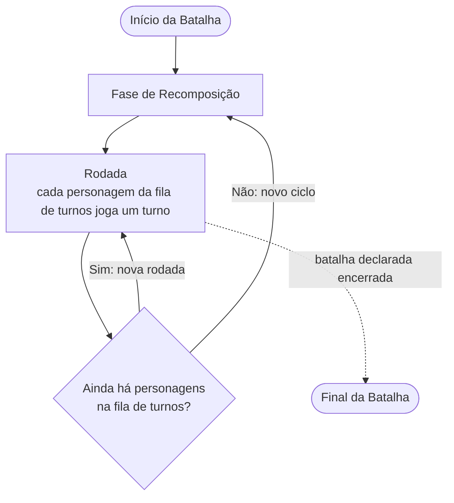

{{ review() }}

# Ciclo

{{ briefing `Stint` `O ciclo é o período entre uma ` + resetPhase + ` e a próxima. Nele, os personagens jogam em rodadas, na ordem da fila de turnos, até a fila ficar vazia.` }}

A batalha se divide em ciclos, cada ciclo em rodadas, e cada rodada nos turnos dos personagens. Só os personagens têm turno: um objeto não age e, por isso, não tem turno.

---

## Batalha [!badge text="Battle" variant="ghost"]

A batalha abre com o {{ startOfBattle }}, antes de qualquer ação dos personagens, e fecha com o {{ endOfBattle }}, quando é declarada encerrada. São os momentos dos efeitos com essas palavras-chave.

Entre os dois, joga-se um ciclo após o outro.

---

## Fase de Recomposição [!badge text="Reset Phase" variant="ghost"]

Todo ciclo começa por esta fase, em três passos:

1. É o momento dos efeitos {{ resetPhase }}.
2. Todos os personagens são ordenados por [Iniciativa](/battle/initiative.md), formando a fila de turnos do ciclo.
3. Cada personagem recebe pontos de {{ ap }} iguais à sua {{ agi }}, no mínimo **3** e no máximo **25**, somados aos que já tem.

Os pontos de {{ ap }} não se perdem de um ciclo para o outro: o que sobra fica guardado. Mas um personagem nunca tem mais pontos de {{ ap }} do que a sua {{ agi }} somada ao seu nível. O que passar disso se perde. Esse máximo nunca fica abaixo de **3**.

!!!secondary Exemplo
Um personagem de nível **10** e **10** de {{ agi }} pode ter até **20** de {{ ap }}.

* Ele encerra o ciclo com **3** de {{ ap }}. Na {{ resetPhase }}, um efeito lhe dá **2**, e depois ele recebe **10**: fica com **15**.
* Se tivesse guardado **15**, ficaria com **20**, e os outros **5** se perderiam.
!!!

---

## Rodada [!badge text="Round" variant="ghost"]

Na rodada, cada personagem da fila de turnos joga um turno, na ordem da fila. Quando todos jogaram, começa uma nova rodada com quem continua na fila.

---

## Turno

{{ briefing `Turn` `O turno é a vez de um personagem agir na batalha.` }}

No seu turno, o personagem age: move a sua peça, ataca, ativa efeitos, etc., pagando o custo de cada ação.

O turno termina quando o personagem faz uma ação que encerra o turno ou encerra o seu ciclo. Então joga o próximo personagem da fila. As ações que encerram o turno são:

* ativar por conta própria um efeito ou uma [técnica](/gameplay/technique.md), de qualquer origem, como uma carta ou um [Modelo](/battle/piece/dummy.md);
* fazer um [ataque normal](/battle/#ataque-normal).

Ativar por conta própria é escolher um efeito e ativá-lo manualmente, sem gatilho e sem ser em [resposta](/gameplay/effect.md#responder-a-um-efeito) a outro efeito. Assim, não encerram o turno os efeitos {{ permanent }} e {{ auto }}, nem um efeito {{ activate }} que foi engatilhado ou ativado em resposta.

Nenhuma outra ação encerra o turno. Ficar sem pontos de {{ ap }} também não: o personagem continua podendo fazer as ações que não custam {{ ap }}.

Os efeitos de fase inicial, como {{ yourStartPhase }}, acontecem no início do primeiro turno de cada personagem no ciclo, e os de fase final, como {{ yourEndPhase }}, quando o ciclo dele termina.

---

## Encerrar o Ciclo

O ciclo de um personagem termina quando:

* ele declara que encerra o seu ciclo, o que pode fazer a qualquer momento, mesmo sem ter agido no turno;
* um turno seu termina e ele está sem pontos de {{ ap }};
* ele faz uma {{ allIn }}, que é a única ação dele no ciclo.

Ao encerrar o ciclo, o personagem sai da fila de turnos e não volta a ela neste ciclo, mesmo que receba pontos de {{ ap }}. Se for o seu turno, o turno termina.

!!!
Encerrar o ciclo só tira o personagem da fila de turnos. Ele continua podendo ativar efeitos em [resposta](/gameplay/effect.md#responder-a-um-efeito) e efeitos [engatilhados](/gameplay/effect.md#requerimentos-de-ativação), pagando os custos deles, inclusive em {{ ap }}. Por isso, guardar pontos de {{ ap }} pode ser estratégico.
!!!

!!!secondary Exemplo
Na {{ resetPhase }}, a fila de turnos fica A, B e C, com **5**, **3** e **4** de {{ ap }}.

**Rodada 1**

* A move a sua peça, gastando **2** de {{ ap }}, e ativa uma carta que custa **1** de {{ ap }}. A ativação encerra o turno, e A fica com **2** de {{ ap }}.
* B ativa uma carta que custa **3** de {{ ap }}. O turno termina com B sem {{ ap }}, o que encerra o seu ciclo.
* C encerra o seu ciclo sem agir e guarda os seus **4** de {{ ap }}.

**Rodada 2**

* Só A continua na fila. Ele move a sua peça, gastando os seus **2** de {{ ap }}. Sem {{ ap }}, o turno continua: A ativa um efeito que não custa {{ ap }}, e o turno termina, encerrando o seu ciclo.

Fora da fila, B e C ainda podem responder às cartas de A, e C pode pagar essas respostas com os {{ ap }} que guardou.

A fila de turnos ficou vazia: o ciclo termina, e o próximo começa pela {{ resetPhase }}.
!!!

---

## Entrar e Sair da Fila de Turnos

Um personagem que sai do tabuleiro, morre ou é nocauteado sai da fila de turnos. Mover a peça no tabuleiro não altera o seu lugar na fila.

Um personagem que entra na fila durante o ciclo, depois da {{ resetPhase }}, como quem volta ao tabuleiro, é revivido ou acorda, entra no **final** da fila. Ele não recebe pontos de {{ ap }} ao entrar, pois só os recebe na {{ resetPhase }}, mas continua com os que já tinha.

Quem já encerrou o seu ciclo não volta à fila neste ciclo, mesmo que volte ao tabuleiro.

!!!secondary Exemplo
Um efeito tira do tabuleiro uma peça com **5** de {{ ap }} e a traz de volta uma rodada depois. Ela entra no final da fila, ainda com os seus **5** de {{ ap }}.
!!!

!!!
Se o personagem voltar durante a {{ resetPhase }}, como acontece com a maioria dos efeitos que retiram personagens do tabuleiro, ele entra na fila de turnos recalculada para o novo ciclo e recebe pontos de {{ ap }} normalmente.
!!!

---

## Simultaneidade de Efeitos
Note que todos os efeitos que devem ser aplicados durante uma determinada fase são aplicados simultaneamente, ou seja, todos acontecem ao mesmo tempo, não tendo uma sucessão ou ordem a ser seguida.

!!!
Por exemplo: Se um efeito diz que “No início do seu turno você deve deitar 2 de {{ mp }}” e outro efeito diz que “No início do seu turno você recupera 2 de {{ mp }}”, ambos os efeitos correm simultaneamente, portanto você não pode usar a {{ mp }} recuperada no segundo efeito para pagar o primeiro.

Neste caso recomenda-se como boa prática, aplicar todos os efeitos dedutivos primeiro e então aplicar os efeitos de recuperação, isso evita que recursos sejam utilizados antes de estarem disponíveis.
!!!
