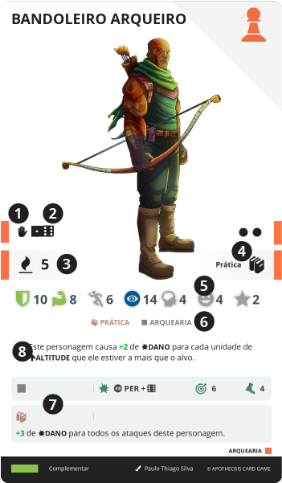

{{ review() }}

# COMPANHEIRO

> Representa um personagem que auxilia o herói em sua jornada. Pode ser desde um companheiro de batalha, um animal de estimação, um servo, um espírito, um ser etéreo ou qualquer outro ser vivo animado que possa ajudar o herói.

São personagens humanos, animais ou evocações. Diferente de um [Herói](/hero/), cujas características, conhecimentos, e habilidades são uma composição de várias cartas, os {{ companion }} são personagens definidos inteiramente por uma única carta que contém todas as informações necessárias para sua utilização, não possuindo {{ table }} e {{ inv }}, mas sim, sendo um NPC controlado pelo [Cartomante](/gameplay/game-master.md) ou parte da {{ table }} de um [Herói](/hero/).

||| :icon-file-moved:

||| :icon-arrow-down-right:
1. **Tipo**

1. **Caminho**

1. **Valor em Vontade**

1. **Nível e Conhecimentos**

1. **Atributos Base**: Valores base dos [Atributos](/gameplay/attributes.md) próprios deste {{ companion }}

1. **Tipos de Anexos**: Características de cartas anexadas que desbloqueiam técnicas desta carta

1. **Técnicas**: Ações e efeitos próprios deste {{ companion }}

1. **Efeito**: Texto do efeito desta carta
|||

---

## Tipo

A carta de {{ companion }} pode ser de **6** tipos diferentes, que são representados por ícones. O tipo da carta é importante para determinar como ela interage com outras cartas e mecânicas do jogo.

###  Humano

TODO

###  Criatura

TODO

###  Evocação

> Evocações são seres artificiais, criados a partir da vontade de uma pessoa, combinada com uma magia específica de criação.
>
> Elas podem assumir qualquer forma, bem como possuir certas habilidades. Isso é realizado através de uma complexa e minuciosa transformação do éter em matéria viva, que é operada por um evocador, um personagem que possui o conhecimento e a habilidade necessários para criar e controlar essas criaturas. O processo de criação de uma evocação é extremamente complexo, e requer um profundo entendimento de como moldar e manipular a energia etérea para criar um corpo físico animado (criar corpo e espírito).
>
> O resultado é uma energia viva que deve ser depositada em um material armazenador de éter, talhado de uma forma que se assemelhe à forma evocada da criatura, mantendo assim a energia em um formato transformável na forma final. Esses objetos são chamados de _totens_ e são feitos geralmente de madeira mágica, por ser mais abundante e fácil de trabalhar, mas podendo ser feitos de qualquer outro material armazenador de éter.

> Quando uma nova evocação é criada, sua fórmula de criação é única, e pode ser compartilhada, aprendida ou recriada por outros evocadores. Ao criador, cabe a tarefa de dar um nome para esta nova espécie, e tradicionalmente a terminação “ero” é utilizada (_Perc**ero**, El**ero**, etc._). Porém, é também comum o uso de nomes de criaturas vindas da mitologia ou fantasia que se assemelhem de certa forma àquela evocação.

> Para alguns, criar um ser vivo é uma blasfêmia ou corrupção da natureza, e isso deve ser deixado apenas para o **Grande Criador**; já outros veem isso como uma forma de se tornarem cocriadores ou apenas ter servos úteis. Apesar disso, existem diferenças claras entre uma evocação e um ser natural: evocações são albinas, com pouca ou nenhuma coloração no corpo, e são incapazes de se reproduzir. Além disso, as evocações não possuem um ciclo de vida natural, seus corpos têm pouca duração e se desfazem depois de alguns minutos, precisando ser recriados pelo evocador na próxima vez que forem evocadas.

TODO

Personagens desse tipo são desevocados ao final do combate.

#### Evocar
A carta de evocação permanece oculta até que seja evocada e não possui peça no tabuleiro. Para ser evocada, é necessário que o evocador (Herói) selecione uma casa adjacente vazia, e pague **2** de {{ mp }} por nível da carta.

Quando evocada, a carta é revelada e a peça do personagem evocação é adicionada na casa do tabuleiro selecionada.

Um COMPANHEIRO evocado é colocado no final da fila de turnos na rodada em que é evocado; na rodada seguinte ele é posicionado na fila de turnos conforme sua Iniciativa.

#### Desevocar
O evocador pode, a qualquer momento do seu turno, desevocar sua evocação; para isto ele anuncia a ação, oculta a carta da evocação e remove a peça dela do tabuleiro.

#### Morte da Evocação
Diferente de outros personagens, quando uma evocação morre, ela é desevocada (sua carta é ocultada) e sua peça é removida do tabuleiro, não deixando corpo; se ela possuir cartas anexadas, elas não devem ser descartadas. Quando desevocada dessa forma, ela não pode ser evocada novamente até o final da batalha.

###  Autômato

- Reviver e curar não funcionam em autômatos, mas sim **Reparar**, que é feito por efeito de carta ou mecânica de jogo
  - *Reparar*: Descarte ícones de mech para reparar 25 de {{ hp }} por ícone descartado. Sendo que isso vale mesmo quando mortos, podendo recuperar vida e até voltarem à vida se for o caso.
- Um personagem só pode consertar autômatos do conhecimento e nível que ele possui
  - O autômato tem que estar adjacente. Isso gasta all-in do personagem que reparar
- Autômatos não podem descansar, nem outras atividades do tipo
- Quando um efeito diz “Recuperar HP” e não curar/reparar, ele ainda vale no autômato
- A grande vantagem do autômato é que eles são imortais. Eles não são descartados apenas se ao final do combate não forem recondicionados.
- Eles ainda podem sofrer perda total normalmente

###  Vigilante

Quando no turno de um vigilante, pode ser jogado com qualquer outro vigilante, porém usa-se os {{ ap }} do personagem do turno.

###  Drako

---

## Caminho

Um {{ companion }} pode ou não pertencer a um caminho, que é uma linha de evolução. O caminho é representado por um ícone de uma peça de dominó, que é o mesmo para todas as cartas daquele caminho.

Os 20 caminhos são:

| Caminho | {{ human }}                                        | {{ creature }} e {{ summon }} | {.compact}
| ---     | ---                                                | ---                           |
|       | Magos, feiticeiros, bruxas                         | Fantásticos                   |
|       | Estudiosos, pesquisadores, cientistas, alquimistas | Humanoides                    |
|       | Herbalistas, druidas, xamãs, curandeiros           | Sintéticos                    |
|       | Guerreiros, espadachins                            | Quimeras                      |
|       | Religiosos, sacerdotes, clérigos                   | Marinhos                      |
|       | Arqueiros, pistoleiros, atiradores                 | Insetos                       |
|       | Militares, mercenários, policiais, soldados        | Anfíbios                      |
|       | Bárbaros, selvagens, domadores, párias             | Feras                         |
|       | Eremitas, andarilhos, buscadores, filósofos        | Pássaros                      |
|       | Comerciantes, jogadores, trapaceiros, mercadores   | Mecanizados                   |
|       | Trabalhadores, profissionais, artesãos, ferreiros  | Primatas                      |
|       | Caçadores, armadilheiros, rastreadores, batedores  | Roedores                      |
|       | Ladrões, assassinos, espiões                       | Felinos                       |
|       | Artistas, bardos, músicos, dançarinos              | Peixes                        |
|       | Ocultistas, cultistas, necromantes                 | Dragões                       |
|       | Brigões, lutadores                                 | Répteis                       |
|       | Aventureiros, exploradores, caçadores de tesouros  | Crustáceos                    |
|       | Mentalistas, ilusionistas, hipnólogos              | Canídeos                      |
|       | Cavaleiros, heróis                                 | Equinos                       |
|       | Vasculhadores, sobreviventes, desajustados         | Lendários                     |
| {{ world }} | _Usado apenas por casos especiais, como summus._ | |

---

## Recrutar

Ao custo de 2 de {{ ap }}, esta carta pode ser enviada para um espaço disponível no {{ support }} do Herói.

- Se o personagem for {{ human }} ou {{ creature }}, ele deve ser colocado em uma [casa de reforço do tabuleiro](/battle/board.md#casa-de-reforço). Se não houver casas de reforço disponíveis, o personagem não pode ser recrutado.

- Se o personagem for uma {{ summon }}, coloque sua peça em uma casa adjacente ao Herói. Se não houver nenhuma casa adjacente disponível, este personagem não pode ser evocado.

---

## Abandonar

Ao custo de 2 de {{ ap }}, esta carta pode ser enviada do {{ support }} para o {{ inv }} do Herói.

- Se o personagem for {{ human }} ou {{ creature }}, é necessário que haja uma [casa de reforço do tabuleiro](/battle/board.md#casa-de-reforço) disponível para que o personagem possa ser retirado do tabuleiro. Se não houver casas de reforço disponíveis, o personagem não pode ser abandonado.

- Se o personagem for uma {{ summon }}, remova sua peça do tabuleiro.

---

## Anexos

Um {{ companion }} pode ter até **5** cartas anexadas a ele.

Durante o turno do Herói, ao custo de **2** de {{ ap }}, ele pode anexar uma carta do seu {{ inv }} a um de seus {{ companion }} que esteja em uma casa adjacente a ele no tabuleiro. Da mesma forma, ao custo de **2** de {{ ap }}, ele pode desanexar uma carta de um de seus {{ companion }} adjacente a ele, enviando-a de volta para o seu {{ inv }}. (No [Modo Narrativo](/gameplay/game-mode/story-mode.md), anexar e desanexar pode ser feito livremente.)

### Restrições de Anexo

- **Apenas Cartas de Recurso**: Somente cartas de Recurso podem ser anexadas a um {{ companion }} por esta mecânica. Uma carta de Ficha só pode ser anexada a um {{ companion }} se um efeito especificar isso explicitamente.
- **Mesmo Tipo e Caminho**: Um {{ companion }} **não** pode ter anexada a ele outra carta de {{ companion }} que possua o mesmo **Tipo** e o mesmo **Caminho** que ele, mesmo que por efeito, a não ser que seja uma carta de nível inferior anexada por meio da mecânica de [Evoluir](#evoluir).

### Características de Anexo

As características de anexos marcam características desejadas de cartas anexadas àquele {{ companion }}. As cartas anexadas não precisam ter esta característica, mas se tiverem, podem desbloquear técnicas em sua hospedeira.

A característica listada abrange basicamente qualquer elemento de uma carta, como valores, propriedades, efeitos, etc. Para que a característica seja válida, ela deve ser do mesmo nível da carta hospedeira.

---

## Evoluir

Este é o processo de evoluir um {{ companion }} que está no seu {{ support }} utilizando uma carta de {{ companion }} do seu {{ inv }} que possua o **mesmo Tipo**, o **mesmo Caminho** e **nível imediatamente superior** (do nível **1** para o **2**, ou do nível **2** para o **3**), observando se o Herói cumpre os requerimentos de {{ knowledge }} e nível da nova carta, e se o limite de **5** anexos será respeitado.

1. Selecione a carta de {{ companion }} no seu {{ inv }} de mesmo Tipo, mesmo Caminho e nível imediatamente superior ao do {{ companion }} no seu {{ support }}.
2. Substitua a carta atual no {{ support }} pela nova carta. A nova carta recebe tudo o que pertencia à carta anterior (seus anexos, contadores, marcadores, etc.).
3. A carta anterior passa a ficar **anexada** à nova carta de {{ companion }} (posicionada sob ela de forma que suas técnicas permaneçam visíveis).
4. O {{ companion }} hospedeiro passa a ter acesso às **técnicas** da carta anexada por meio desta evolução.

Se um {{ companion }} de nível **2** que já possui um {{ companion }} de nível **1** anexado evoluir para o nível **3**, a carta de nível **1** é mantida como anexo e a carta de nível **2** também passa a ficar anexada ao novo {{ companion }} de nível **3**, que passa a ter acesso às técnicas de ambas as cartas anexadas.

---

## Personagem

Cartas de {{ companion }} são tratadas como personagens, e portanto, possuem uma peça no tabuleiro, podem ser atacados, mortos, realizar testes, etc., tal qual um Herói.

### Pagamento de Custos

Os COMPANHEIROS podem ser requeridos a pagar certos custos pelo efeito de outras cartas ou mecânica de jogo, como descartar cartas e valores.

Observando que COMPANHEIROS não possuem MESA nem {{ inv }}, quando um texto especificar uma ação impossível para um COMPANHEIRO, como “descarte do seu {{ inv }}” ou “deite 2 de {{ mp }}”, o personagem não tem como cumprir aquela exigência, logo, ela deve ser ignorada quando forem consequências dessa ação; quando forem requerimentos da ação, então ele não tem como cumprir estes requerimentos e a ação não pode ser realizada.

Porém, quando o texto não apresenta uma restrição, por exemplo, “descarte uma carta” ou “descarte pontos de {{ fate }}”, o COMPANHEIRO pode/deve utilizar seus anexos nestes casos. Note que se o custo for obrigatório, o personagem precisa pagar, se for opcional o jogador pode optar.

A mesma consideração deve ser feita quando uma carta é obtida pelo COMPANHEIRO, se o texto disser algo como “enviado para o {{ inv }}”, o COMPANHEIRO não tem como realizar esta ação, mas se o texto apenas diz que a carta é “obtida”, ela pode/deve ser anexada ao companheiro, ainda respeitando o limite de anexos.

### Vida

A {{ hp }} da peça de um companheiro no tabuleiro é determinada da mesma forma que para um Herói.

### Morte

Quando um {{ companion }} morrer, sua carta deve ser enterrada e todas as cartas anexadas devem ser descartadas para o {{ tradingPost }}, exceto {{ item }}, que podem ser saqueados do seu corpo.

### Morte do Herói

Se o Herói morrer, o jogador deve continuar a batalha utilizando as peças de {{ companion }} do tipo {{ human }} e/ou {{ creature }} que lhe restam no tabuleiro, ignorando quaisquer efeitos dados pelo Herói. Se o Herói possuir {{ companion }} do tipo {{ summon }}, eles são desevocados imediatamente.

### Técnica

---
