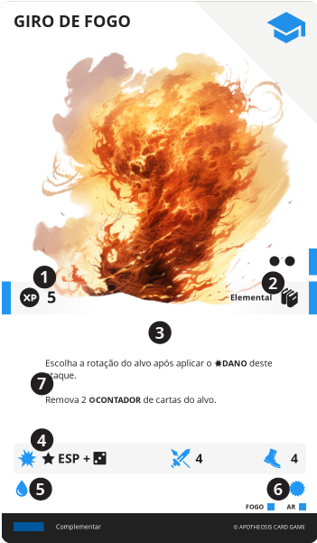

{{ review() }}

# HABILIDADE

Representam novas capacidades físicas, mentais e espirituais adquiridas por um personagem, conforme ganha experiência de vida, que concedem efeitos e modificadores.

||| :icon-file-moved:

||| :icon-arrow-down-right:
1. **Valor em {{ xp }}**

1. **Nível e {{ knowledge }}**

1. **Bônus**: Bônus passivos imediatos providos por esta carta

1. **Efeito**: Texto do efeito desta carta

1. {{ dmg }}

1. {{ range }}

1. {{ ap }}

1. {{ sp }}

1. {{ mp }}
|||

---

## Aprender

Ao custo de 2 de {{ ap }}, esta carta pode ser enviada para um espaço disponível no {{ mem }} do Herói.

---

## Esquecer

Ao custo de 2 de {{ ap }}, esta carta pode ser enviada do {{ mem }} para o {{ inv }} do Herói.

---

## ATIVAR
Se uma {{ skill }} em seu {{ mem }} possuir "Custo de {{ ap }}", você deve pagar este custo para executar seu efeito. Em adicional, deve deitar cartas do seu {{ mem }} cuja soma de suas {{ sp }} e a soma de suas {{ mp }} sejam iguais ou superiores às da carta sendo executada.

LEVANTAR O TROCO: Caso seja deitada uma quantidade superior à necessária, você pode levantar cartas do {{ mem }} cuja soma de suas {{ sp }} e a soma de suas {{ mp }} sejam iguais ou inferiores ao valor extra pago.

!!!
Note que a própria carta possui a quantidade de {{ sp }} e {{ mp }} que ela requer. Assim, deitar a própria carta já é o suficiente para ativá-la.

Uma {{ skill }} deitada não está de forma alguma "desativada", e pode ser usada normalmente, desde que pagos seus custos. A carta estar deitada simboliza apenas que os recursos de {{ sp }} e {{ mp }} que ela disponibiliza já foram utilizados.
!!!

Ao executar uma {{ skill }}, o jogador deve verificar se o efeito deve ser usado neste momento e se a {{ skill }} possui um {{ range }}. O que significa que ele deve selecionar um alvo no tabuleiro, que esteja dentro desse limite. Se a {{ skill }} também possuir um {{ dmg }}, o alvo recebe este {{ dmg }}.

---
