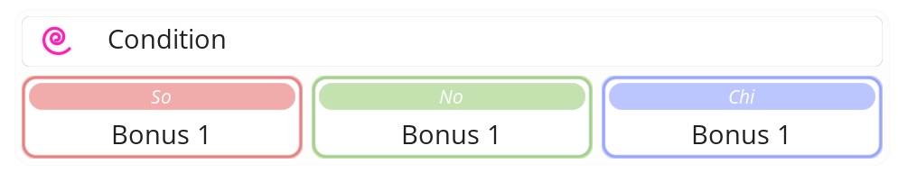

#  Ascensus

> *Ascensus* é o termo latino para *“ascensão”*, no sentido de subir, elevar-se, alcançar um nível superior.

> *So - No - Chi* é uma contração de *Soma - Nous - Psyche*, que são os termos gregos para corpo, mente e espírito, respectivamente.

Em jogo, o {{ ascensus }} são cartas de {{ entity }} que não são um {{ entity }} em si, mas sim uma transformação do seu {{ entity }} na {{ sheet }}. Representam um estado de ascensão de um Herói, onde ele alcança um nível superior de poder, compreensão ou conexão com o éter através de seu {{ entity }}. Isso é feito quando o Herói atinge um nível de compreensão elevado dos elementos que o constituem, corpo, mente e espírito, e de como eles se relacionam com o éter e entre si. O Herói se torna então capaz de colocar esses elementos em perfeita harmonia, alcançando um estado de equilíbrio e sintonia com o éter, o que lhe permite acessar um poder e conhecimento superiores usando o seu {{ entity }} como canal.

Ao atingir esse estado, o personagem entra no Modo Ascendido. Existem diversos métodos para atingir esse estado, que se manifestam na forma das várias cartas de {{ ascensus }}. Cada carta representa o conceito e ideia por trás daquele modo de ascensão, mas todas elas trabalham com o conceito central de harmonização do corpo, mente e espírito.

Uma vez que o personagem tenha aprendido aquele método, ele inicia sua transformação verbalizando forte e claramente as palavras de ordem: _So - No - Chi_.

O poder adquirido se manifesta na forma de bônus altíssimos de Atributos.

---

## Mecânica

- A carta de {{ ascensus }} é colocada oculta na **Zona Extra** do Herói.
- Quando revelada, a carta de {{ ascensus }}
  - Concede seus bônus em cada Atributo.
  - Seus efeitos podem ser usados normalmente.
  - Adicione **20** {{ counterAscended }} a esta carta
- A primeira linha da caixa de mecânica indica uma condição que o {{ entity }} do Herói deve cumprir para poder revelar o {{ ascensus }}.
- A caixa de mecânica do {{ ascensus }} possui 3 colunas com valores indicados. O jogador deve calcular o valor de cada coluna e somar os 3 resultados. Essa soma é então aplicada como bônus em cada Atributo do Herói.
- {{ counterAscended }} são a energia especial do modo Ascendido. Eles são gastos tanto pelo tempo quanto pelas ações do Herói, além de servirem como um escudo etéreo.
  - Na {{ yourStartPhase }}, remova **2** {{ counterAscended }} desta carta.
  - Ao ativar uma carta, remova **1** {{ counterAscended }} desta carta.
  - Ao realizar um Ataque Normal, remova **1** {{ counterAscended }} desta carta.
  - Quando sofrer {{ dmg }}, ao invés de calcular a {{ injury }} e remover {{ hp }}, para cada {{ n"50" }} de {{ dmg }} sofrido, remova **1** {{ counterAscended }} desta carta. Logo, um ataque que cause {{ n"60" }} de {{ dmg }} remove 1, um ataque de {{ n"90" }} remove 1, um ataque de {{ n"120" }} remove 2, e assim por diante.
  - Quando esta carta não tiver mais {{ counterAscended }}, o Herói perde o estado de Ascendido. O {{ ascensus }} é ocultado imediatamente.
- Quando a carta de {{ ascensus }} é ocultada por qualquer motivo, o turno do personagem é encerrado imediatamente. Se isso ocorrer durante uma batalha, o personagem não recupera {{ ap }} na próxima {{ resetPhase }}.

||| Caixa de Mecânica

- : Condição que o {{ entity }} do Herói deve cumprir para poder revelar o {{ ascensus }}
- So: Quantidade de pontos de bônus recebidos
- No: Quantidade de pontos de bônus recebidos
- Chi: Quantidade de pontos de bônus recebidos
|||

==- :icon-feed-star:ㅤUsar
- A carta de {{ ascensus }} está em uso quando ela está revelada na **Zona Extra** do Herói.
- O Herói precisa ter um {{ entity }} na {{ sheet }} que cumpre as condições do {{ ascensus }}.
- O Herói pode revelar o {{ ascensus }} durante o seu turno, **sem custos**.
- Para revelar a carta o jogador deve verbalizar claramente o comando _"So - No - Chi"_.
- O personagem pode usar seu {{ ascensus }} apenas uma vez a cada dia, ou seja, depois de ocultada, a carta não pode ser usada novamente por 5 períodos completos do dia.

==- :icon-feed-issue-closed:ㅤRequerimentos
- O Herói deve ter um {{ entity }} na {{ sheet }} que cumpre as condições do {{ ascensus }} na sua **Zona Extra** para revelar o {{ ascensus }}.
- Se, a qualquer momento, o Herói não tiver mais um {{ entity }} na {{ sheet }} ou o {{ entity }} na {{ sheet }} não cumprir as condições do {{ ascensus }} na sua **Zona Extra**, oculte o {{ ascensus }} na sua **Zona Extra**.
- Se na {{ yourEndPhase }} o Herói não tiver mais um {{ entity }} na {{ sheet }}, ele deve descartar o {{ ascensus }} da sua **Zona Extra**.

==- :icon-feed-plus:ㅤObter
Quando não estiver em batalha, você pode realizar uma {{ allIn }} e {{ banish }} {{ n 3 }} {{ entity }} do {{ tradingPost }}, para adicionar um {{ ascensus }} à sua **Zona Extra**.

==- 	:icon-x-circle-fill:ㅤRemover
Quando não estiver em batalha, você pode realizar uma {{ allIn }} para descartar um {{ ascensus }} da sua **Zona Extra**.

===

---

Adicionais

==- Modo Ascendido

Quando no modo Ascendido, narrativamente, o Herói é dito como no _modo \<nome da carta\>_, ou seja, se a carta se chamar _Alinhamento Triádico_ o Herói é dito como no _modo Alinhamento Triádico_.

===

---
