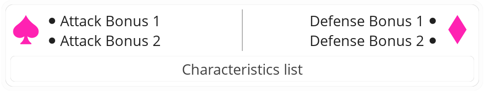

#  Corpus

> *Corpus* é o termo latino para *“couraça”*, no sentido de proteção, defesa.

Em jogo, a [<b>CORPUS</b>](/gameplay/summus/corpus.md), também conhecida como *Aetherframe* (estrutura etérea), representa a superação definitiva dos limites da carne. Quando um Herói alcança um estágio em que as restrições do corpo humano já não permitem seu progresso, ele pode construir para si não uma simples armadura, mas um novo corpo, forjado a partir de matérias novas ou diversas, criadas pela manipulação direta do éter.

Para habitar essa estrutura, o corpo original do Herói, juntamente com suas vestes, equipamentos, pensamentos, conhecimentos, bênçãos, encantamentos e todas as energias ao seu redor, é inteiramente revertido ao estado puro de éter. Essa essência completa é então depositada no interior da nova carapaça, que passa a servir como seu novo corpo.

Esses *Aetherframe* possuem uma abertura, geralmente no peito, por onde a própria essência do Herói é depositada em seu interior. Uma [<b>CORPUS</b>](/gameplay/summus/corpus.md) necessita de outras energias adicionais para operar, e cada corpo construído possui suas próprias exigências para funcionar.

---

## Usar

- Os anexos desta carta não podem ser alvos ou sofrer efeitos que não o efeito da própria [<b>CORPUS</b>](/gameplay/summus/corpus.md).
- Os anexos desta carta não podem ser adicionados ou removidos individualmente, apenas a [<b>CORPUS</b>](/gameplay/summus/corpus.md) inteira pode ser *construída* ou descartada.
- Quando você sofrer perda total, bana esta carta, remova sua peça do tabuleiro e permaneça com metade do seu [<b>VIDA</b>](/hero/#vida) máximo.
- A [<b>CORPUS</b>](/gameplay/summus/corpus.md) recebe o valor integral da soma dos bônus de atributos das cartas de Ficha anexadas a ela, provendo esse bônus diretamente ao Herói.
- A carta pode ser ocultada ou revelada a qualquer momento, ao custo de **4** de [<b>AÇÃO</b>](/hero/#ação).

||| Caixa de Mecânica

- : Bônus de ataque fornecido
- : Bônus de defesa fornecido
- ***Lista de Características***: Características necessárias.
|||

==- Requerimentos
É necessário ter o nível de [<b>CONHECIMENTO</b>](/gameplay/knowledge.md) da carta para obter esta carta.
- Se em algum momento o Herói perder o [<b>CONHECIMENTO</b>](/gameplay/knowledge.md) e/ou nível necessário, esta carta deve ser descartada.

O Herói não pode ter cartas com quaisquer dos especificados [<b>VESTE</b>](/cards/item.md#fabricar), [<b>CABEÇA</b>](/cards/item.md#fabricar) e/ou [<b>PÉS</b>](/cards/item.md#fabricar).
- Ao obter ou revelar uma [<b>CORPUS</b>](/gameplay/summus/corpus.md), envie quaisquer cartas com estes especificadores para o [<b>INVENTÁRIO</b>](/hero/inventory.md).

==- Obter
Esta carta é obtida fazendo a troca equivalente de recursos, ou seja comprando com [<b>PREÇO</b>](/cards/item.md) do [<b>ENTREPOSTO</b>](/gameplay/stack/trading-post.md) ou recebida como recompensa.

A carta é então adicionada diretamente à zona extra.

Ao obter uma [<b>CORPUS</b>](/gameplay/summus/corpus.md), o Herói deve construir, montar ou configurar a estrutura etérea, isso é chamado de *assinatura*, e é a marca pessoal do Herói na criação de seu novo corpo. Essa configuração é feita anexando as seguintes **3** cartas à [<b>CORPUS</b>](/gameplay/summus/corpus.md).

[<b>ENTE</b>](/cards/entity.md)
:    Qualquer

[<b>CLASSE</b>](/cards/class.md)
:    De um caminho que o Herói possua (Exceto )

Recurso
:    Uma carta de recurso com pelo menos uma das características listadas na caixa de mecânica.

==- Remover
Você pode realizar uma [Ação Total](/gameplay/effect.md) para descartar uma [<b>CORPUS</b>](/gameplay/summus/corpus.md) da sua **Zona Extra**.

===

---
