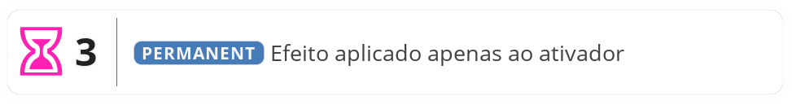

!!!danger
Esta seção ainda não foi completamente revisada. Algumas informações podem estar desatualizadas ou incompletas, e a formatação pode não estar finalizada.
!!!
    
#  Dominium

> Dominium é o termo latino para “domínio”, no sentido de posse, território, propriedade.
>
> O Dominium é uma dimensão forjada pela vontade do seu criador à sua imagem e semelhança. É uma zona interdimensional que, quando ativada, se entrelaça com o espaço-tempo ao redor do seu conjurador criando uma área no local, com regras e características próprias, definidas pela mente e magia do seu criador, e onde ele é deus.
>
> Por este motivo, são representados por cartas de [<b>EVENTO</b>](/cards/event.md) no [<b>CENÁRIO</b>](/gameplay/stack/scenario.md), aplicando seus efeitos a todos.

[<b>DOMINIUM</b>](/gameplay/summus/dominium.md) são cartas de [<b>EVENTO</b>](/cards/event.md) que quando ativadas do [<b>INVENTÁRIO</b>](/hero/inventory.md) são enviadas para o [<b>CENÁRIO</b>](/gameplay/stack/scenario.md) para aplicar efeitos a todos os personagens.

 

#### Regras Especiais

- Para ativar um [<b>DOMINIUM</b>](/gameplay/summus/dominium.md) do seu [<b>INVENTÁRIO</b>](/hero/inventory.md) o Herói deve consumir **10** de **Energia** e então enviar a carta para o [<b>CENÁRIO</b>](/gameplay/stack/scenario.md).
    - Apenas um [<b>DOMINIUM</b>](/gameplay/summus/dominium.md) pode estar ativo por vez, portanto não é possível ativar um [<b>DOMINIUM</b>](/gameplay/summus/dominium.md) se já houver outro no [<b>CENÁRIO</b>](/gameplay/stack/scenario.md).
- Enquanto estiver no [<b>CENÁRIO</b>](/gameplay/stack/scenario.md) os bônus e efeitos da carta são aplicados a todos os personagens no tabuleiro.
    - Quaisquer bônus negativos proporcionados pela carta **não** são aplicados ao Herói que a ativou.
    - O efeito na caixa identificadora do [<b>SUMMUS</b>](/gameplay/summus/) é válido apenas para o Herói que a ativou.
- A carta deve ser removida do [<b>CENÁRIO</b>](/gameplay/stack/scenario.md) após passada a quantidade de [Fase de Recomposição](/gameplay/effect.md) definida na carta.
  - O jogador que ativou o [<b>DOMINIUM</b>](/gameplay/summus/dominium.md) pode optar por remover o [<b>DOMINIUM</b>](/gameplay/summus/dominium.md) do [<b>CENÁRIO</b>](/gameplay/stack/scenario.md) antes do tempo.
- Quando no [<b>CENÁRIO</b>](/gameplay/stack/scenario.md), o [<b>DOMINIUM</b>](/gameplay/summus/dominium.md) não pode ser removido por efeito.
- Pode ser ativado apenas no turno do seu dono, e o turno se encerra imediatamente após sua ativação.

 

||| Caixa de Mecânica

- ***Ampulheta***: Quantidade de [Fase de Recomposição](/gameplay/effect.md) até esta carta ser enviada de volta para o [<b>INVENTÁRIO</b>](/hero/inventory.md) do ativador.
- ***Texto***: Efeito que é usado ou aplicado apenas pelo ativador desta carta. São sempre [Permanente](/gameplay/effect.md).
|||

---
