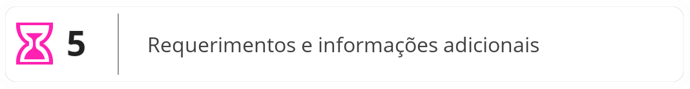

{{ review() }}

#  Ultimatum

> Ultimatum é o termo latino para "último", e refere-se a uma ação final ou definitiva.
> 
> O Ultimatum de um Herói é sua habilidade mais poderosa e definitiva, que quando carregada e pronta, pode mudar o rumo da batalha.

{{ ultimatum }} são cartas de {{ skill }}, focados em causar uma enorme quantidade de {{ dmg }} em um único ataque, e/ou em causar um efeito devastador na {{ table }} do oponente ou no tabuleiro.

São as {{ summus }} mais simples de serem utilizadas e ativadas, o que as torna bastante versáteis e compatíveis com diversas {{ table }}.

 

#### Regras Especiais

- Possuem custo fixo de {{ ap }} igual a **9**.
- No início e no fim da Batalha, remova todos os {{ counter_ultimate }} desta carta.
- No início de cada rodada de batalha, adicione um {{ counter_ultimate }} a esta carta.
- Quando esta carta possuir a quantidade mínima de {{ counter_ultimate }}, você pode ativar esta carta.
- Remova todos os {{ counter_ultimate }} desta carta após ativá-la.
- Nenhuma carta pode ser ativada em resposta a esta ativação.
- Cada Herói pode ativar apenas um {{ ultimatum }} por batalha.

 

||| Caixa de Mecânica

- : Número de {{ counter_ultimate }} necessários para ativar a carta.
- *Texto*: Instruções adicionais de uso e ativação da carta.
|||

---
